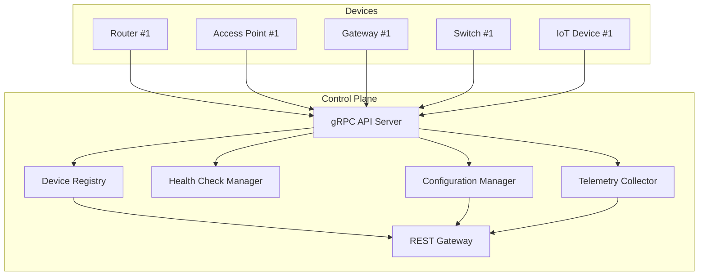

# Network Control Plane

> Cloud-native control plane for distributed network device management

[](https://goreportcard.com/report/github.com/yourusername/network-control-plane)
[](https://opensource.org/licenses/MIT)

## Overview

Lightweight gRPC-based control plane for managing distributed network devices (routers, access points, IoT gateways). Provides device registration, health monitoring, configuration management, and real-time telemetry collection.

## Architecture



## Features

### Core

-  gRPC-based device communication
-  Real-time health monitoring
-  Device registry with metadata
-  Configuration distribution and management
-  Telemetry collection and aggregation
-  REST API for queries and monitoring

### Monitoring

-  Prometheus metrics
-  Docker-based deployment
-  Device command & control
-  Health status tracking (online/offline/degraded)
-  Fleet statistics and monitoring

## Quick Start

### Prerequisites

- Go 1.21+
- Docker & Docker Compose
- protoc (Protocol Buffers compiler)

### Setup

```bash
# Clone the repository
git clone <repository-url>
cd network-control-plane

# Install dependencies
make dev-setup

# Build the project
make build

# Or run with Docker Compose
make demo
```

### Running locally

```bash
# Terminal 1: Start the control plane server
make run-server

# Terminal 2: Start a simulated device
make run-device
```

### Running with Docker Compose

```bash
# Build and start the full stack
make demo

# View logs
make docker-logs

# Query devices via REST API
make query
```

## API Documentation

### gRPC API

The control plane exposes a gRPC API for device communication:

- `Register(RegisterRequest) returns (RegisterResponse)`: Device registration with metadata
- `Heartbeat(HeartbeatRequest) returns (HeartbeatResponse)`: Periodic health status updates
- `StreamTelemetry(stream TelemetryData) returns (TelemetryResponse)`: Real-time metrics and events
- `GetConfiguration(ConfigRequest) returns (stream Configuration)`: Configuration distribution
- `ExecuteCommand(Command) returns (CommandResponse)`: Remote command execution
- `Deregister(DeregisterRequest) returns (DeregisterResponse)`: Device cleanup

### REST API

The control plane provides a REST API for monitoring and management:

- `GET /api/v1/devices` - List all devices with status and metrics
- `GET /api/v1/devices/{id}` - Get specific device details and history
- `GET /api/v1/stats` - Fleet statistics by status and type
- `GET /metrics` - Prometheus metrics endpoint
- `GET /health` - Control plane health check

## Components

### Control Plane Server
- gRPC server for device communication
- Device registration and authentication
- Configuration distribution
- Telemetry collection
- Command/control interface

### Device Registry
- In-memory store for device state
- Device metadata management
- Query interface by status, type, etc.
- Health history tracking

### Health Check Manager
- Periodic health checks (configurable interval)
- Device status tracking (online/offline/degraded/unknown)
- Failure detection and alerting
- Heartbeat monitoring with timeout detection

### Configuration Manager
- Configuration distribution to devices
- Version tracking for configurations
- Bulk configuration updates by device type/tag
- Configuration rollback capability

### Telemetry Collector
- Receive and process telemetry streams from devices
- Time-series buffer for recent telemetry data
- Aggregation and filtering capabilities
- Integration with Prometheus metrics

### REST API Gateway
- HTTP REST interface for queries
- Prometheus metrics endpoint
- Admin operations
- Demo/visualization support

## Configuration

The server accepts the following command-line flags:

```bash
./server --port 50051 --rest-port 8080
```

- `--port`: gRPC server port (default: 50051)
- `--rest-port`: REST API server port (default: 8080)

## Monitoring

The control plane exposes Prometheus metrics at `/metrics`. Key metrics include:

- `control_plane_devices_total` - Number of registered devices by status and type
- `control_plane_heartbeats_total` - Total heartbeats received by device type
- `control_plane_registrations_total` - Total device registrations
- `control_plane_grpc_duration_seconds` - gRPC request duration histogram

## Use Cases

1. **IoT Device Fleet Management** - Manage thousands of edge devices
2. **Network Infrastructure** - Monitor router/AP mesh networks
3. **Edge Computing** - Coordinate edge computing nodes
4. **Firmware Updates** - Orchestrate device updates across fleet
5. **Health Monitoring** - Real-time device status and performance tracking

## Performance

- Supports 1000+ concurrent device connections
- Sub-50ms health check processing
- 10K events/sec telemetry ingestion
- Sub-100ms API query response (p95)

## Functional Requirements

### Device Registration (FR-1)
- Devices register with control plane on startup (FR-1.1)
- Provide device metadata (type, MAC, IP, firmware version, capabilities) (FR-1.2)
- Control plane assigns unique device ID (FR-1.3)
- Support device re-registration (handle restarts) (FR-1.4)
- Deregister devices gracefully on shutdown (FR-1.5)

### Health Monitoring (FR-2)
- Periodic health checks (configurable interval, default 30s) (FR-2.1)
- Track device status: ONLINE, OFFLINE, DEGRADED, UNKNOWN (FR-2.2)
- Detect devices that haven't responded in 90s as OFFLINE (FR-2.3)
- Collect device metrics (CPU, memory, uptime, bandwidth) (FR-2.4)
- Maintain health history (last 100 health checks) (FR-2.5)

### Configuration Management (FR-3)
- Push configuration updates to devices (FR-3.1)
- Devices acknowledge configuration receipt (FR-3.2)
- Support configuration rollback (FR-3.3)
- Version tracking for configurations (FR-3.4)
- Bulk configuration updates by device type/tag (FR-3.5)

### Telemetry Collection (FR-4)
- Devices stream telemetry data (metrics, logs, events) (FR-4.1)
- Aggregate telemetry at control plane (FR-4.2)
- Expose metrics via Prometheus endpoint (FR-4.3)
- Store recent telemetry (time-series buffer) (FR-4.4)

### Query Interface (FR-5)
- REST API to list all devices (FR-5.1)
- Query devices by status, type, location, tags (FR-5.2)
- Get individual device details (FR-5.3)
- Get aggregated fleet statistics (FR-5.4)
- Search devices by MAC/IP/hostname (FR-5.5)

### Command & Control (FR-6)
- Send commands to devices (reboot, update firmware, run diagnostics) (FR-6.1)
- Track command execution status (FR-6.2)
- Command timeout and retry logic (FR-6.3)
- Command audit logging (FR-6.4)

## Project Structure

```
network-control-plane/
├── api/
│   └── proto/                 # Protocol buffer definitions
├── cmd/
│   ├── server/               # Control plane server entry point
│   ├── device/               # Device simulator
│   └── cli/                  # CLI tool for admin operations
├── pkg/
│   ├── server/               # Server implementation
│   ├── registry/             # Device registry
│   ├── health/               # Health monitoring
│   ├── config/               # Configuration management
│   ├── telemetry/            # Telemetry collection
│   └── device/               # Device-related utilities
├── internal/
│   ├── auth/                 # Authentication logic
│   ├── metrics/              # Prometheus metrics
│   └── logger/               # Logging setup
├── test/
│   ├── integration/          # End-to-end tests
│   └── load/                 # Load testing
├── deploy/
│   ├── kubernetes/           # Kubernetes deployment configs
│   └── prometheus/           # Prometheus configuration
├── examples/                 # Example configurations
├── scripts/                  # Utility scripts
└── Makefile                  # Build and deployment commands
```

## Development

### Building from source

```bash
# Generate protobuf code
make proto

# Build binaries
make build

# Run tests
make test

# Run integration tests
make test-integration
```

### Testing

The project includes:
- Unit tests for core components
- Integration tests for component interactions
- Load tests for performance validation

Run all tests:
```bash
make test
```

### Docker Compose Demo

The demo includes:
- 1 Control Plane server
- 4 simulated devices (2 routers, 1 access point, 1 gateway)
- Prometheus monitoring
- All connected via a virtual network

Start the demo:
```bash
make demo
```

## Deployment

### Docker Compose (Development)
Use `docker-compose.yml` for local development and testing with multiple devices.

### Kubernetes (Production)
Kubernetes deployment files are available in `deploy/kubernetes/` for production deployment.

## Future Enhancements

- [ ] Persistent storage (etcd/PostgreSQL)
- [ ] Multi-region support
- [ ] Firmware update orchestration
- [ ] Advanced analytics dashboard
- [ ] Authentication and authorization (mTLS)
- [ ] Device command audit trails
- [ ] Advanced configuration templating
- [ ] Real-time alerting system

## Relevance to Network Ecosystem

This control plane demonstrates patterns applicable to managing network device ecosystems like ASUS routers, mesh Wi-Fi systems, and IoT gateways. Key capabilities:

- Device lifecycle management
- Health monitoring at scale
- Configuration distribution
- Real-time telemetry
- Fault detection and recovery
- Command & control capabilities

## License

MIT
